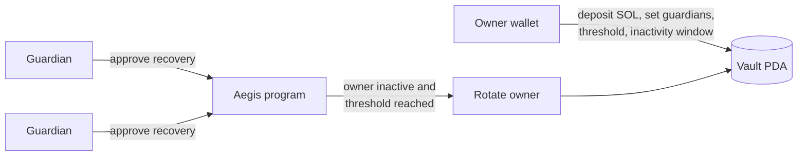

  

  
  
  
  

---

### 👋 About me

I'm a full stack engineer with **3 years of production experience** building web apps, DeFi platforms and AI-powered products. I'm now going deep on machine learning from first principles, building neural networks from scratch, on my way into AI safety work.

Open to remote roles, and to relocating for the right role or fellowship.

### 🔭 Right now

| | |
|---|---|
| 🧠 **Learning** | Andrej Karpathy's *Zero to Hero*: micrograd → makemore → GPT, built from scratch |
| 🔐 **Training** | Rektoff Solana Security Bootcamp, cohort 6 |
| 💼 **Looking for** | AI engineering and AI safety roles, remote or with relocation |

---

### 📌 Featured projects

  
  
  
  

---

### 🧠 AI and ML

<b>makemore: character-level language models in PyTorch</b>

 

| Model | Dev loss |
|---|---|
| Bigram (counting) | 2.45 |
| MLP, 10-character context | 2.09 |
| MLP + BatchNorm | **2.04** |

Every model has tests, results across random seeds and an ablation study. → [**HarshS1611/makemore**](https://github.com/HarshS1611/makemore)

<b>elementaryGPT: a transformer from scratch that writes like Sherlock Holmes</b>

 

A character-level GPT written from scratch in PyTorch and trained on all nine Sherlock Holmes books. 4.82M parameters, validation loss 1.27, with tests and a reproducible sampler (fixed temperature and seed).

> **Prompt:** "Watson," said Holmes, " 
> **Model:** that good everything must be promised. I should have always put the lady through the situation of the case."

It has learned Conan Doyle's voice (dialogue, Victorian vocabulary, names), not plot or meaning, which is expected at this size. → [**HarshS1611/elementaryGPT**](https://github.com/HarshS1611/elementaryGPT)

<b>FlowSend: AI-assisted remittances on Base</b> · <a href="https://flowsend-mini-app-alpha.vercel.app/">live app</a>

 

A remittance app on Base that uses LLM API calls to flag anomalous transfer patterns and suspicious behaviour, with escrow smart contracts built using AgentKit and the CDP SDK. → [**Devfolio**](https://devfolio.co/projects/flowsend-bac3) · [**HarshS1611/base-mini-app**](https://github.com/HarshS1611/base-mini-app)

---

### ◎ Solana and Web3

<b>Aegis: guardian-based key recovery on Solana</b> · <a href="https://aegis-protocol-dusky.vercel.app/">live app</a>

 

A non-custodial vault: if the owner goes inactive, a threshold of guardians can rotate ownership, but guardians never touch the funds. Anchor program in Rust, tested with LiteSVM, with a Next.js frontend. Deployed on Solana devnet. Built during Turbin3 Builders, Q2 2026.

→ [**HarshS1611/Aegis**](https://github.com/HarshS1611/Aegis)

### 🌐 Open source

<b>Protocol Labs, Storacha and DefiLlama</b>

 

- **[DefiLlama](https://github.com/DefiLlama/dimension-adapters/pulls?q=is%3Apr+author%3AHarshS1611):** contributor to fee and volume adapters.
- **Protocol Labs developer grant** (FIL-Builders / Storacha), Jan 2025 to Mar 2026:
  - [**storacha-migration-tool**](https://github.com/HarshS1611/storacha-migration-tool): a TypeScript library that streams files and folders from AWS S3 straight to Storacha, without downloading them locally. Published on npm.
  - [**toju (afara)**](https://github.com/tojunetwork/afara): a crypto-native onramp for decentralized storage on IPFS via Storacha, paid in SOL, USDFC or USDC, with agent payments over x402.
- **Protocol Labs Dev Guild:** participant across cohorts 2 to 6, about 11 months.

### 🏆 Hackathon wins

**Unfold 2024** · **ETHIndia 2022** · **Mercor Chatbot Challenge 2023** · **E-Hack VIT**

---

### 🧰 Languages and tools

  
  
  
  
  
  
  
  
  
  
  
  
  

  
  
  
  
  

### 📊 GitHub activity

  
  

---

  

<i>Happy to talk about machine learning, AI safety or Solana. Reach out on LinkedIn or by email.</i>

